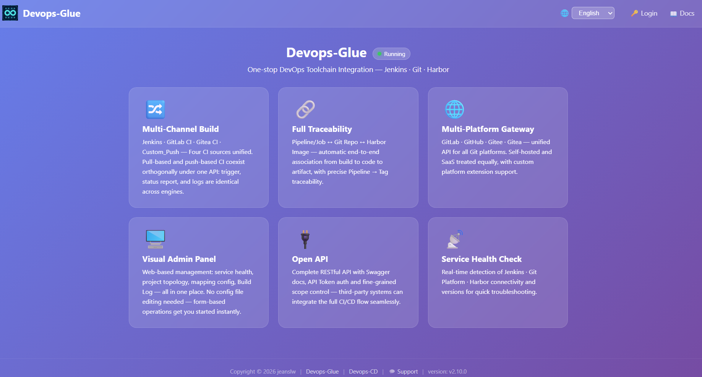
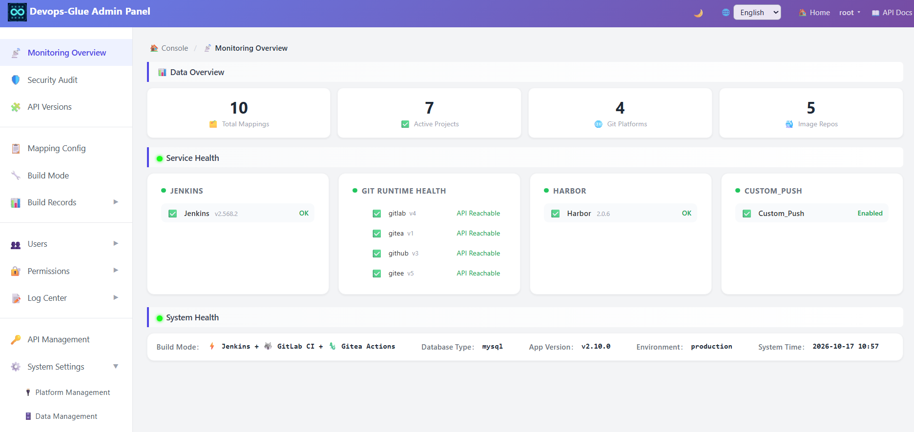

# Devops-Glue API
DevOps-Glue API is a Slim 4–based integration platform designed to enhance DevOps toolchains for small teams. It provides a unified view, RBAC, and RESTful APIs, with support for multiple mainstream Git platforms and CI-agnostic integration.

<p align="center">
  <strong>🔧 Lightweight CI Management Service | Swiss Army Knife for Small Teams</strong><br/>
  Built with PHP + Slim4 — A CI & CD data aggregation platform designed for small teams
</p>

<p align="center">
  <a href="https://github.com/jeanslw/Devops_CD"></a>
  <a href="https://github.com/jeanslw/Devops-Glue/releases/latest"></a>
  <a href="https://github.com/jeanslw/Devops-Glue"></a>
  <a href="https://github.com/jeanslw/Devops-Glue/blob/main/LICENSE"></a>
  <a href="https://www.php.net"></a>
  <a href="https://www.slimframework.com"></a>
  <a href="https://hub.docker.com/r/jeanslw/devops-glue/tags"></a>
</p>

> 🔗 **This is a CI enhancement component** | Full system requires the CD deployment service → [Devops_CD](https://github.com/jeanslw/Devops_CD)


##  Why Devops-Glue + CD?

> 🔧 **A Unified Management Console for Jenkins / GitLab CI / Gitea CI / Custom CI**
> ✅ Make your distributed Jenkins instances, GitLab CI projects, Gitea CI projects and custom CI manageable, visualizable, and auditable

- 🔍 **Unified Build View**: Cross-engine search and aggregation of all build history — no more platform switching
- 📝 **Unified Log Center**: Operation logs, API access logs, and deploy logs
- 🔧 **Support LDAP/SSO Login**: Easily integrate into the company's internal management system, say goodbye to information silos, and achieve account connectivity
- 📝 **Custom_Push**: Orthogonal push-based CI — pull and push coexist simultaneously. [\[**Use case**\]](docs/ADMIN_MANUAL.md#12-configure-build-mode)
- 🚀 **Supports Horizontal Scaling**: nginx/web/mysql are in separate containers, with an architecture designed to support horizontal scaling by default
- 🔐 **Fine-grained RBAC**: More flexible access control than native plugins, tailored for team-scale organizations
- 🚀 **Non-invasive Integration**: API-only connection with zero changes to existing CI configs — onboard in about 10 minutes

> **[Chinese](README_ZH-CN.md)**




## Features

- **Custom Push CI (Custom_Push)** — Your CI pushes → Devops-Glue stores metadata only; orthogonal to pull-based CI, can be enabled simultaneously
- **Multi-Build Channels** — Jenkins + GitLab CI + Gitea CI + Custom_Push, switch or coexist freely
- **Unified Logs** — The Log Center includes operation logs, API access logs, and CD deployment logs — for security and log auditing
- **Build Records** — Pull-based and push-based build records unified into one build log view; see everything at a glance instead of hunting across systems
- **Multi-Platform Git** — GitLab · GitHub · Gitee · Gitea, built in-house or SaaS
- **Full-Chain Mapping** — Job/Pipeline/Actions ID ↔ Git repo ↔ Harbor image tag ↔ CD deployment; code→build→artifact auto-association, forming a complete chain together with the CD service
- **Security Scan Audit** — SAST, secret scanning, dependency vulnerability detection, written back via Commit Status
- **Role-Based Access (RBAC)** — Multi-level custom roles with per-role permissions. Built-in system roles; every other role and its permissions are created by admins in the console, with permission keys and implied rules stored in the database
- **Unified API** — Secure tokens with revocation & deletion and fine-grained scope control, for secure third-party calls such as the CD service
- **Admin Dashboard** — Service monitoring / mapping config / security scan / user management / build modes / build records / log center / API management / system settings
- **Authoritative Build Artifacts** — Obtained via scan-sync write-back in the normal build flow; stale records are safely auto-cleaned; on write-back failures they can be back-filled via log derivation; every build artifact must be verified through the image registry
- **Zero-Config Startup** — SQLite by default, one-click switch to MySQL / MariaDB (recommended)
- **i18n** — Chinese / English bilingual interface, `?lang=` instant switching via `symfony/translation` 

##  Architecture Overview
<details>
<summary>Click to expand</summary>

```
┌──────────────────────────────────────────────────────────────────────────────┐
│                                CODE PUSH                                     │
│          GitLab / Gitee / GitHub / Gitea  →  Webhook Trigger                 │
└────────────────────────────────────┬─────────────────────────────────────────┘
                                     ↓
┌──────────────────────────────────────────────────────────────────────────────┐
│                     CI LAYER：Devops-Glue API (PHP)                          │
│                                                                              │
│  ┌──────────────┐  ┌──────────────┐   ┌──────────────┐    ┌───────────────┐  │
│  │   Jenkins    │  │  GitLab CI   │   │   Gitea CI   │    │  Custom Push  │<──── User CI
│  │ BuildProvider│  │ BuildProvider│   │ BuildProvider│    │ (custom_push) │  │   (pusher)
│  └──────┬───────┘  └──────┬───────┘   └──────┬───────┘    └───────┬───────┘  │
│         └─────────────────┼──────────────────┼────────── ─────────┼          │
│                                    ↓                                         │
│                    Build → Docker Image → Harbor Registry                    │
│                                    ↓                                         │
│                      scan-sync → ci_pipeline_artifacts                       │
└────────────────────────────────────┬─────────────────────────────────────────┘
                                     ↓									 
┌──────────────────────────────────────────────────────────────────────────────┐
│                          CD 层：Devops-cd (Python)                           │
│                                                                              │
│                         选择 Project + Tag  ──→  部署执行                    │
│                                                                              │
│		   ┌──────────────┐  ┌──────────────┐  ┌──────────────┐                │
│		   │  SSH Script  │  │Docker Compose│  │  Kubernetes  │                │
│		   │    Ansible   │  │  SFTP + up   │  │ kubectl/Helm │                │
│		   │              │  │              │  │ ArgoCD/FluxCD│                │
│		   └──────────────┘  └──────────────┘  └──────────────┘                │
│                                    ↓                                         │
│                        cd_deploy_logs (Deployment Records)                   │
│                                    ↓                                         │
│                        DingTalk / WeCom Webhook Notifications                │
└──────────────────────────────────────────────────────────────────────────────┘	
```
</details>

## Quick Start
<details>
<summary>Click to expand</summary>

```bash
# 1. Clone
git clone https://github.com/jeanslw/Devops-Glue.git
cd Devops-Glue

# 2. Install dependencies
composer install

# 3. Configure environment
cp config/app.env.example config/app.env
# Edit config/app.env with your actual credentials

# 4. Start (PHP built-in server or Docker)
php -S 0.0.0.0:8080 -t public/
# OR
docker compose up -d --build

# 5. Verify
curl http://localhost:8080/api/health
```

Visit `http://localhost:8080/admin` for the admin panel (credentials in `config/app.env`).

Visit `http://localhost:8080/api/docs` for interactive API docs (Swagger UI).
</details>

## Requirements

| Component | Version | Deployment |
|---|---|---|
| Language | PHP 8.1+ | — |
| Package Manager | Composer v2.9.4 | — |
| Database | SQLite / MySQL 8.0+ / MariaDB 10.4+ | Self-hosted or SaaS |
| Jenkins | v2.60+ | Self-hosted |
| GitLab | v9.0+ (API v4) | Self-hosted |
| Gitea | v1.27.x (API v1) | Self-hosted |
| GitHub | API v3 | SaaS |
| Gitee | API v5 | SaaS |
| Harbor | v1.10.1 / v2.x | Self-hosted |

> **Harbor robot account:** calling the REST API via a robot account requires Harbor **v2.2.0+** (secret-based). On v1.x / v2.0.x / v2.1.x the robot token is a JWT (Docker/Helm CLI only) — use a normal account instead. See [docs/ADMIN_MANUAL.md](docs/ADMIN_MANUAL.md#11-connect-harbor).

See [docs/ADMIN_MANUAL.md](docs/ADMIN_MANUAL.md) for full environment variable reference and CORS configuration.

## Documentation

| Document | Language | Description |
|----------|----------|-------------|
| [API Reference](docs/API_Reference.md) | EN | API endpoints, request/response formats, quick tests |
| [ARCHITECTURE](docs/ARCHITECTURE.md) | EN | Overall data flow, component relationships, deployment pattern matrix|
| [Admin Manual](docs/ADMIN_MANUAL.md) | EN | Environment variables, mapping config, custom Git platform |
| [User Manual](docs/USER_MANUAL.md) | EN | User Guide|
| [Single Sign-On](docs/Single-Sign-On.md) | EN | OAuth2 / OIDC SSO for Jenkins / Harbor / GitLab |
| [Technical Guide](docs/Technical-Guide.md) | EN | Architecture, DB design, data flows, troubleshooting |
| [Integrated Service Version Compatibility](docs/Integrated-Service-Version-Compatibility.md) | EN | Jenkins / GitLab / Gitea / Harbor version support and boundaries |
| [FAQ](docs/FAQ.md) | EN | Common issues and troubleshooting |
| [Changelog](docs/CHANGELOG.md) | — | Release notes |
| [Contributing Guide](CONTRIBUTING.md) | EN | How to write / translate / keep EN & CN docs in sync |

## Related Projects

- **Devops-CD** — Continuous Deployment system that can be used alongside this system:  
  https://github.com/jeanslw/Devops_CD

## License

MIT

## Contact

- Issues & PRs: [GitHub Issues](https://github.com/jeanslw/Devops-Glue/issues)
- Email: jeanslw@qq.com
