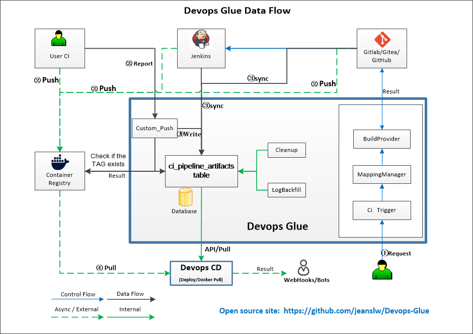

# Devops-Glue 架构全景图

## 整体数据流



## 组件关系

```
┌────────────────────────────────────────────────────────────┐
│           共享/独立数据库 (SQLite/MySQL/MariaDB)           │
│                                                            │
│  ci_*               ← CI 读/写                             │
│  cd_*               ← CD 读/写                             │
└────────────────────────────┬───────────────────────────────┘
			                 │
		              ┌──────┴──────┐
		              ↓             ↓
			   ┌─────────────┐ ┌─────────┐
			   │ Devops-Glue │ │Devops-CD│
			   │    :8080    │ │  :8081  │
			   └─────────────┘ └─────────┘
```

> **数据库选型**：Devops-Glue 与 CD Service 推荐使用同一个数据库实例，但非必须——两端经 HTTP API 交互，`ci_*` 与 `cd_*` 表互不冲突，因此分库（或不同 driver）也可行。
> - **SQLite**：零配置，适合单机开发/测试。容器部署时必须将 `config/data/` 目录挂载为共享卷，确保两边进程能访问同一个 `.db` 文件。
> - **MySQL 8.0+ / MariaDB 10.4+**：推荐生产环境使用，支持并发读写，无需共享卷。

## 控制器模块

`src/Controller/` 按功能域拆分。原 `AdminController`（单类承载全部后台能力）已拆为 `Admin/` 命名空间下的 12 个控制器，共享基类 `BaseAdminController`（操作日志 / 客户端 IP / 拓扑缓存失效 / 超级管理员校验等公共能力），各自只依赖本域所需的服务：

| 控制器 | 职责 |
|---|---|
| `MainController` | 健康检查 / 映射列表 / 平台发现 |
| `BuildController` | 构建触发 / Pipeline / 扫描 / commit-status |
| `GitController` | 分支查询 |
| `HarborController` | Harbor 镜像仓库查询 / 扫描 |
| `RegistryController` | 通用镜像仓库列表（Harbor / registry:2） |
| `Admin\AuthController` | 登录 / 登出 / 改密 / 登录锁 / 我的权限 |
| `Admin\UserController` | 用户增删改查 / 状态 / 改密 |
| `Admin\RoleController` | 角色增删改查 |
| `Admin\PermissionController` | 权限注册 / 删除 / 隐含规则 |
| `Admin\ApiTokenController` | API Token 管理 |
| `Admin\ConfigController` | 构建模式 / 平台级配置 |
| `Admin\ConnectionController` | 平台连接配置 |
| `Admin\OidcController` | OIDC 配置 |
| `Admin\VersionController` | 平台 API 版本管理 |
| `Admin\MappingController` | CI/镜像映射与自动发现 |
| `Admin\LogController` | 审计与构建日志 |
| `Admin\SystemController` | 系统信息 / 迁移 / 备份 / tag 任务 |

## 部署拓扑（容器拆分）

CI Web 层**无状态**——token 鉴权（无 `$_SESSION`），所有状态都在共享数据库，因此可水平扩展。唯一需要单实例的是定时任务，已拆分到独立的 worker 容器。容器拆分为三部分：

| 服务 | 镜像 | 运行内容 | 端口 | 副本 |
|---|---|---|---|---|
| `nginx` | `nginx:1.22-alpine`（官方） | 边缘入口：静态文件直接返回，PHP 请求 fastcgi 转发到 `web` | 80 → 宿主机 8080 | 1 |
| `web` | `devops-glue:latest` | 纯 php-fpm（无 nginx / supervisor） | 9000（FastCGI，仅内网） | 1..N（无状态） |
| `worker` | `devops-glue:latest` | supervisord → 4 个 cron 循环 | — | 1 |

- **`nginx`** 是唯一 HTTP 入口。`./public` 只读挂载到 `/app/public` 直接返回静态文件；`.php` 请求 `fastcgi_pass` 到 `glue_php` upstream（`web:9000`）。
- **`web`** 跑镜像默认 `CMD`（`php-fpm -F`），不设 container_name/ports，`docker compose up -d --scale web=N` 即可水平扩展；扩展后重启 `nginx` 让其重新解析 upstream 的 Docker DNS。
- **`worker`** 覆盖 command 为 `supervisord -n -c /etc/supervisor/conf.d/supervisord.conf`，跑下方 4 个 cron 循环。

### worker 定时任务

| program | CLI | 间隔环境变量（默认） |
|---|---|---|
| `tag-cleanup` | `cli/cleanup-pipeline-tags.php` | `TAG_CLEANUP_INTERVAL`（3600s） |
| `tag-backfill` | `cli/backfill-pipeline-tags.php` | `TAG_BACKFILL_INTERVAL`（1800s） |
| `api-log-cleanup` | `cli/cleanup-api-access-logs.php` | `API_ACCESS_LOG_CLEANUP_INTERVAL`（86400s） |
| `db-backup` | `cli/backup-db.php` | `DB_BACKUP_INTERVAL`（86400s） |

### 分布式定时任务锁

为保证即使误起多个 worker 副本，同一时刻也只有一个实例执行，CLI 在执行前都会在 `ci_cache` 表获取**租约锁**（`Database::tryAcquireLock` / `releaseLock`）：

- 锁键为 `cache_key = 'lock:<name>'`，跨实例共享（MySQL 多实例，或 SQLite 共享单文件）。
- 抢占时先删除已过期租约，再用普通 `INSERT` 写入自己的租约——唯一键冲突说明他者持有有效锁 → 退出 0（跳过）。
- 租约在 TTL 后自动过期，持有者崩溃也不会死锁调度；释放按 token 精确匹配，超时被接管后不会误删新持有者的锁。

```
                 nginx  × 1（边缘入口：静态 + fastcgi）──────┐
                                                             ▼
                 web  × N（php-fpm，无状态）   ← 水平扩展
                          │
                          ▼  共享数据库（MySQL / SQLite）
                 worker  × 1（4 个 cron 循环，DB 租约锁）
```

> **SQLite**：仍是单文件数据库——挂载一个共享 `data/db` 卷；锁经同一文件的 WAL busy-timeout 串行化。多实例真并发建议用 MySQL。

### 裸机部署（Bare-metal）

不依赖 Docker/supervisord 时，部署分两块：

- **Web 层**：常规 nginx + php-fpm（无状态、可水平扩展）。`nginx` 的 `root` 指向项目根 `public/`（唯一入口 `index.php`），`try_files` 重写到 `index.php` 走 Slim 路由，PHP 请求经 fastcgi 转发到 php-fpm。仓库内 `config/docker/nginx.conf` 即现成模板，把容器路径 `/app` 换成实际部署路径即可。
- **定时任务**：容器里由 worker 的 supervisord sleep-loop 驱动，裸机改用系统 cron（或 systemd timer）定时调用两个 CLI：

```cron
# 每小时清理过期 tag（对应 TAG_CLEANUP_INTERVAL，默认 3600s）
0 * * * * www-data php /opt/devops-glue/cli/cleanup-pipeline-tags.php >> /var/log/devops-glue/tag-cleanup.log 2>&1
# 每 30 分钟回填日志 tag（对应 TAG_BACKFILL_INTERVAL，默认 1800s）
*/30 * * * * www-data php /opt/devops-glue/cli/backfill-pipeline-tags.php >> /var/log/devops-glue/tag-backfill.log 2>&1
```

注意事项：

- **开关默认关闭**：两任务受后台开关 `stale_tag_cleanup_enabled` / `backfill_tag_enabled` 控制（默认关），须先在「平台配置」页开启，否则 CLI 打印「跳过」并退出 0。
- **运行用户**：须与 Web 进程（php-fpm）同用户（如 `www-data`），否则 root 先跑会创建 root 属主的 SQLite 库文件，导致 Web 侧写入失败。
- **env 加载**：CLI 经 `cli/bootstrap.php` 自动加载 `config/app.env`（路径相对 `__DIR__`，不依赖工作目录），crontab 无需 `cd`。
- **分布式锁兜底**：CLI 内置 `ci_cache` 表租约锁，即使误配多份 cron 或与容器 worker 混跑，同一时刻也只一个实例执行，抢不到锁直接退出 0。
- **日志目录**：重定向的日志目录须对运行用户可写。

## CI 构建模式：Pull-based 与 Push-based

Devops-Glue 支持两种正交的 CI 模式，可同时启用：

### Pull-based CI（传统模式）

- **开关**：`build_mode` —— 启用的 CI 源集合（`jenkins` / `gitlab_ci` / `gitea_ci`，多选）
- **方向**：Devops-Glue 主动调用 CI API 触发构建、轮询状态、获取镜像 tag
- **Provider**：`JenkinsBuildProvider`、`GitlabCiBuildProvider`、`GiteaCiBuildProvider`
- **数据流**：Devops-Glue → CI API → Build → 镜像仓库 → `scan-sync`（Harbor，含扫描报告）或 `registry-sync`（任意仓库，不读取扫描） → `ci_pipeline_artifacts`

### Push-based CI（Custom_Push 模式）

- **开关**：`custom_push_enabled`（独立布尔开关，与 `build_mode` 正交）
- **方向**：用户自己的 CI 脚本主动推送构建状态、日志 URL、镜像 tag 到 Devops-Glue
- **Provider**：`CustomPushBuildProvider`（实现 `BuildProviderInterface`）
- **数据流**：用户 CI → Devops-Glue API → `ci_custom_builds`（元数据）+ `ci_pipeline_artifacts`（镜像 tag）

### 正交设计

`build_mode` 与 `custom_push_enabled` 互不依赖，可任意组合：

| build_mode（启用的 CI 源） | custom_push_enabled | 效果 |
|---|---|---|
| jenkins | false | 仅 Jenkins 拉取式 CI |
| gitlab_ci | false | 仅 GitLab CI 拉取式 CI |
| gitea_ci | false | 仅 Gitea Actions 拉取式 CI |
| jenkins,gitlab_ci,gitea_ci | false | 三种拉取式 CI 同时工作 |
| jenkins | true | Jenkins + Custom_Push 同时工作 |
| gitlab_ci,gitea_ci | true | GitLab CI + Gitea Actions + Custom_Push 同时工作 |

### Custom_Push 关键设计

- **只存元数据**：Devops-Glue 存储 `status`、`log_url` 等元数据到 `ci_custom_builds` 表，镜像 tag 规范化到 `ci_pipeline_artifacts` 表
- **日志代理**：`log_url` 仅作指针，Devops-Glue 通过代理拉取日志内容，**不存储日志原文**。因为 Devops-Glue 无法验证构建结果真实性，日志作为证据必须由执行方（用户 CI）持有
- **API 端点**：
  - `POST /api/build/{path}/report` — 一次性上报终态构建结果与镜像 tag
- **配置驱动**：`CustomPushBuildProvider` 通过 `settings.php` 的 `build.custom_providers` 数组注册，开箱即用
- **自动发现**：启用 `custom_push` 后，自动发现会扫描 Git 平台寻找配置了 custom_push 的项目
- **pipeline_iid 约束**：为与 `ci_pipeline_artifacts` 表对齐，`pipeline_iid` 必须为整数；重复上报按覆盖（UPDATE）处理

## 部署模式矩阵

| 部署类型 | 模式 | 底层实现 |
|----------|------|---------|
| SSH 单机 | 自定义命令 | Shell 脚本，支持 `{image}` `{tag}` `{project}` 占位符 |
| SSH 单机 | Ansible Playbook | `ansible-playbook -e image={image} -e tag={tag}` |
| Docker Compose | 远程 YAML | `cd {path} && docker compose up -d` |
| Docker Compose | 在线编写 | SFTP 上传 compose YAML → 自动建目录 → 启动 |
| K8s kubectl | SSH apply | SSH 到 master 执行 `kubectl apply -f` |
| K8s Helm | SSH kubectl | `helm upgrade --install` + 版本验证 |
| K8s Argo CD | REST API | PATCH image → sync → 轮询 Healthy |
| K8s Flux CD | SSH kubectl | PATCH 资源 → wait ready |

## 设计模式

- **Strategy 模式**：`BuildProviderInterface`（Devops-Glue）/ `Deployer`（Devops-CD）抽象基类 + Registry 注册表
- **工厂模式**：`GitProviderFactory` 按 URL 自动匹配 Git 平台适配器
- **双驱动数据库**：SQLite / MySQL / MariaDB 统一接口，一套代码三种模式，可与 CD Service 共享同一数据库实例（非必须）
- **正交 CI 设计**：`build_mode`（pull-based）与 `custom_push_enabled`（push-based）独立开关，互不依赖，可任意组合同时启用

## 解决问题

中小型企业 DevOps 工具链碎片化：
- Git 平台（GitLab/Gitee/GitHub/Gitea）→ 统一对接
- CI 引擎（Jenkins/GitLab CI 拉取式 + Custom_Push 推送式，理论上支持所有 CI）→ 统一接入
- 镜像仓库（Harbor）→ 扫描同步
- 部署目标（SSH/Docker/K8s）→ 统一执行
- 通知（钉钉/企微/Webhook）→ 自动推送
